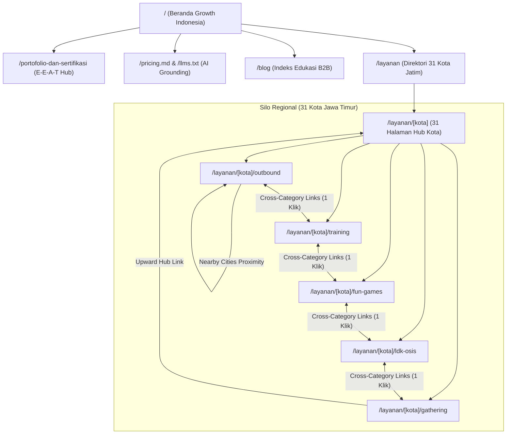

# Blueprint SEO, Site Architecture, Programmatic SEO & Content Strategy - Growth Indonesia

**Entitas Bisnis:** Growth Indonesia (`https://growthindonesia.my.id`)  
**Kantor Pusat:** Jl. Mujair No.3, Nambangan Kidul, Kota Madiun, Jawa Timur 63128  
**Kontak Resmi:** +62 857-0474-8186 (E.164: `+6285704748186`) | `info@growthindonesia.my.id`  
**Pimpinan & Praktisi Utama:** Master Trainer & Praktisi Experiential Learning Berpengalaman (Naftalyndho & Juprianto)  
**Cakupan Wilayah:** 31 Kota & Kabupaten di Jawa Timur (Eks-Karesidenan Madiun, Kediri, Malang Raya, Surabaya Raya, Tapal Kuda, Pantura, dan Madura)

---

## Bagian 1: Strategi AI SEO & Generative Engine Optimization (`/ai-seo`)

Strategi *Generative Engine Optimization (GEO)* untuk **Growth Indonesia** dirancang agar menjadi rujukan sitasi nomor satu di **Google AI Overviews**, **ChatGPT Search**, **Perplexity AI**, dan **Claude** ketika pengambil keputusan B2B (Manajer HRD, Panitia Pengadaan BUMN/Instansi Pemerintah, dan Kepala Sekolah) mencari provider outbound, pelatihan SDM, maupun event organizer di Jawa Timur.

### 1.1 Optimasi Lead-In Passage (40-60 Kata)
Setiap halaman layanan regional (`/layanan/[kota]/[kategori]`) dilengkapi komponen `AiOverviewSection` yang mengekstrak fakta inti dalam satu paragraf padat berjumlah 40 hingga 60 kata di bagian atas konten:
- **Struktur Kalimat:** `[Entitas: Growth Indonesia] + [Layanan Kanonis + Kota] + [3 Venue Populer Lokal] + [Bukti Kuantitatif: 250+ Klien, 15.000+ Peserta, 0 Insiden / Zero Accident Policy] + [Otoritas Praktisi: Master Trainer Naftalyndho & Juprianto]`.
- **Contoh Passage Teroptimasi:**
  > "Growth Indonesia menyediakan layanan Outbound, Corporate Gathering, dan Team Building profesional di Madiun (termasuk area Taman Wisata Umbul, Waduk Bening Widas, Hutan Pinus Nongko Ijo). Dengan rekam jejak menangani 250+ perusahaan, BUMN, dan instansi (15.000+ peserta) serta catatan 0 insiden keselamatan (Zero Accident Policy), setiap program dirancang berbasis experiential learning di bawah supervisi langsung Master Trainer berpengalaman (Naftalyndho dan Juprianto) untuk meningkatkan kepemimpinan, kolaborasi, dan produktivitas tim Anda."

### 1.2 Kepadatan Fakta & Angka Terverifikasi (Fact & Statistic Density)
Mesin pencari generatif (LLM) memprioritaskan sumber yang menyajikan angka konkret dibandingkan klaim subjektif:
- **Tarif Dasar Per Peserta (Per Pax):**
  - Outbound & Team Building (1 Hari): Mulai `Rp 150.000/pax`
  - Fun Games & Ice Breaking (1 Hari): Mulai `Rp 150.000/pax`
  - LDK OSIS & Character Building (1 Hari): Mulai `Rp 150.000/pax`
  - Indoor Training & Capacity Building: Mulai `Rp 200.000/pax`
  - EO Corporate & Family Gathering: Mulai `Rp 250.000/pax`
- **Paket Bundel Institusi:**
  - *Fun Experience Package*: `Rp 5.500.000`
  - *New Generation Camp (LDK & Pemuda)*: `Rp 7.000.000`
  - *The Leaders Package (Executive & Manajerial)*: `Rp 9.500.000`
- **Metrik Rekam Jejak & Keselamatan:**
  - `250+` Perusahaan, BUMN, Instansi Pemerintah, dan Sekolah Mitra
  - `15.000+` Alumni Peserta Pelatihan
  - `31` Kota/Kabupaten Layanan Aktif di Jawa Timur
  - `4.9/5.0` Rating Kepuasan Klien (`250` ulasan terverifikasi)
  - `0` Insiden Keselamatan Kerja (*Zero Accident Policy*)

### 1.3 Sinyal Kesegaran (Freshness Signals) & Ekosistem Grounding (`/llms.txt` + `/pricing.md`)
1. **Badge Validasi Praktisi & Timestamp:** Setiap halaman menampilkan penanda *"Terverifikasi Tim Praktisi Ahli - Diperbarui Oktober 2026"* dan *lastModified* dinamis pada `sitemap.xml`.
2. **Endpoint `/llms.txt` (`app/llms.txt/route.ts`):** Menyediakan ringkasan terstruktur berformat Markdown yang merangkum profil entitas **Growth Indonesia**, daftar 5 kategori kanonis (`/layanan/madiun/outbound`, `/layanan/madiun/training`, `/layanan/madiun/gathering`, `/layanan/madiun/ldk-osis`, `/layanan/madiun/fun-games`), matriks 31 kota layanan, serta kontak resmi.
3. **Endpoint `/pricing.md` (`app/pricing.md/route.ts`):** Dokumen harga berbasis Markdown murni yang dapat diambil langsung oleh *crawler* AI (`GPTBot`, `OAI-SearchBot`, `ClaudeBot`, `PerplexityBot`, `Google-Extended`) tanpa hambatan *rendering* JavaScript, serta ditautkan dari tabel perbandingan harga di seluruh halaman layanan.
4. **Protokol IndexNow (`lib/indexnow.ts`):** Mengirimkan ping otomatis ke Bing/IndexNow (yang menjadi tulang punggung indeks pencarian real-time ChatGPT Search dan Copilot) menggunakan kunci verifikasi `/e368c11258e94b86a9bc1a862c3042da.txt`.

---

## Bagian 2: Audit Teknis & On-Page SEO (`/seo-audit`)

### 2.1 Core Web Vitals & Performa Rendering
| Parameter Teknis | Status Implementasi | Detail Optimasi di Growth Indonesia |
| :--- | :--- | :--- |
| **Rendering Strategy** | **SSG + ISR (`revalidate = 3600`)** | Seluruh 155 halaman pSEO (`/layanan/[kota]/[kategori]`) dan 31 halaman hub kota (`/layanan/[kota]`) di-pre-render secara statis melalui `generateStaticParams()`. |
| **LCP (Largest Contentful Paint)** | **Lulus (< 2.0 detik)** | Hero section menggunakan gradien CSS ringan dan gambar teroptimasi dari CDN (`nafta121.sirv.com` & `images.unsplash.com`) yang terdaftar di `remotePatterns` `next.config.ts`. |
| **CLS (Cumulative Layout Shift)** | **Lulus (< 0.02)** | Ukuran kontainer kartu, tabel perbandingan program (`min-w-[680px]`), dan dimensi gambar OpenGraph (`1200x630`) didefinisikan secara eksplisit. |
| **INP (Interaction to Next Paint)** | **Lulus (< 100 ms)** | Komponen interaktif seperti `KalkulatorBudget` diisolasi sebagai Client Component ringan tanpa membebani *main thread* pada Server Components utama. |

### 2.2 Pengindeksan, Robots.txt, dan Canonical Tags
- **Robots.txt (`app/robots.ts`):** Mengizinkan seluruh bot mesin pencari utama dan *AI Search Crawlers* (`GPTBot`, `OAI-SearchBot`, `ChatGPT-User`, `ClaudeBot`, `PerplexityBot`, `Google-Extended`, `Applebot-Extended`) mengakses seluruh halaman publik, kecuali `/api/` dan `/_next/`.
- **Self-Referencing Canonical & Hreflang:** Setiap halaman memiliki tag `<link rel="canonical">` absolut ke `https://growthindonesia.my.id/...` beserta `alternates.languages['id-ID']`.
- **Penanganan Legacy URL (308 Permanent Redirect):** Permintaan ke pola URL lama seperti `/layanan/outbound-madiun` atau `/layanan/ldk-osis-ponorogo` secara otomatis diarahkan (`permanentRedirect`) oleh `getRedirectDestination()` di `app/layanan/[kota]/page.tsx` menuju struktur kanonis `/layanan/[kota]/[kategori]`.

### 2.3 Hierarki Heading (H1 - H3)
- **H1 (Tunggal per halaman):**
  - Beranda (`/`): Fokus pada *Provider Outbound, Training & Event Organizer Jawa Timur*.
  - Hub Kota (`/layanan/[kota]`): `Layanan Outbound & Training di {Kota}`.
  - Spoke Layanan (`/layanan/[kota]/[kategori]`): Headline kustom per kategori dan kota dari `getContentVariations()`.
- **H2:** Digunakan untuk pembagian seksi utama (*Keunggulan Program*, *Kalkulator Investasi*, *Layanan {Kategori} di Kota Lainnya*).
- **H3:** Digunakan untuk sub-seksi spesifik (*Ringkasan Layanan {Kategori} di {Kota}*, *Pilihan Program & Layanan di {Kota}*, *FAQ Seputar {Kategori} di {Kota}*, dan *Layanan Lainnya di {Kota}*).

### 2.4 Matriks Pencegahan Keyword Cannibalization
Untuk mencegah persaingan antar-halaman di domain yang sama (*keyword cannibalization*), setiap jenis halaman dikunci pada *search intent* dan struktur kata kunci yang berbeda:

| Level Halaman | Pola URL | Target Search Intent | Kata Kunci Utama (Primary Keyword) | Peran Konversi |
| :--- | :--- | :--- | :--- | :--- |
| **Root Homepage** | `/` | Navigational & Brand / Regional Broad | Provider Outbound & Event Organizer Madiun Jawa Timur | Otoritas merek utama, portofolio, kalkulator umum |
| **Directory Index** | `/layanan` | Directory / Exploration | Area Layanan Outbound & EO Jawa Timur (31 Kota) | Distribusi *link equity* ke 31 Hub Kota |
| **City Hub (31 Halaman)** | `/layanan/[kota]` | Local Broad Commercial | Provider Outbound & EO di `{Kota}` | Menangkap pencarian umum per kota & mengarahkan ke 5 kategori |
| **Category Spoke (155 Halaman)** | `/layanan/[kota]/[kategori]` | High-Intent Transactional Local | Jasa `{Kategori}` di `{Kota}` (contoh: *LDK OSIS di Ponorogo*) | Konversi langsung via Kalkulator Budget & WhatsApp per layanan |
| **Editorial Blog** | `/blog/[slug]` | Informational & Research B2B | Panduan, Contoh Rundown, Tips, & Rekomendasi Venue | Edukasi prospek awal & penguatan internal link ke Spoke |
| **Trust & Portfolio** | `/portofolio-dan-sertifikasi` | E-E-A-T Validation & Procurement | Portofolio Klien & Standar Kompetensi Growth Indonesia | Validasi uji kelayakan vendor (HRD/BUMN/Sekolah) |

---

## Bagian 3: Evaluasi Arsitektur Programmatic SEO (`/programmatic-seo`)

Arsitektur Programmatic SEO **Growth Indonesia** mencakup **155 halaman layanan spesifik** (`31 kota x 5 kategori kanonis`: `outbound`, `training`, `fun-games`, `ldk-osis`, `gathering`) ditambah **31 halaman Hub Kota** (`186 halaman regional terindeks`).

### Evaluasi terhadap 10-Point Content Uniqueness Gate (>40% Diferensiasi)

| No | Kriteria Uniqueness Gate | Implementasi pada Codebase Growth Indonesia | Status |
| :--- | :--- | :--- | :--- |
| **1** | **Unique Localized Value Proposition** | Properti `uniqueSellingPoint` di `lib/cities.ts` unik untuk masing-masing dari 31 kota (contoh: *Kawasan Lereng Gunung Lawu* untuk Magetan, *Kampung Inggris & Simpang Lima Gumul* untuk Kediri). | **LULUS** |
| **2** | **Verified Local Venues (3+ per City)** | Properti `popularVenues` di `lib/cities.ts` menyuntikkan 3 rekomendasi lokasi nyata di setiap kota ke dalam badan artikel, ringkasan AI Overview, dan jawaban FAQ dinamis. | **LULUS** |
| **3** | **Local Economic & Industry Context** | Properti `localContext` di `lib/cities.ts` menjelaskan profil industri, karakter instansi, dan ekosistem korporat/akademik yang spesifik di setiap kabupaten/kota. | **LULUS** |
| **4** | **Logistics & Travel Accessibility** | Properti `estimatedTravel` di `lib/cities.ts` memberikan panduan rute tol, kereta api, dan estimasi waktu tempuh menuju titik kumpul kegiatan di kota tersebut. | **LULUS** |
| **5** | **Category-Specific Deliverables** | Fungsi `getContentVariations(kategori, kotaName)` di `lib/content-variations.ts` menghasilkan `bodyIntro`, `subtitle`, dan 4 poin `deliverables` yang sepenuhnya berbeda untuk ke-5 kategori kanonis. | **LULUS** |
| **6** | **Dynamic Localized FAQs (1:1 Schema)** | Fungsi `getCityServiceFaqs(kategoriName, kotaName, venues)` di `lib/schema.ts` menghasilkan pertanyaan dan jawaban yang menyertakan nama kota, kategori, rentang harga, dan daftar venue lokal. | **LULUS** |
| **7** | **Geographic Proximity Clustering** | Fungsi `getNearbyCities(currentCityKey)` di `lib/city-proximity.ts` mengelompokkan kota tetangga berdasarkan kedekatan geografis nyata (bukan urutan abjad acak). | **LULUS** |
| **8** | **Interactive Cost Simulation** | Komponen `KalkulatorBudget` terintegrasi langsung pada setiap halaman Spoke untuk memungkinkan simulasi RAB sesuai jumlah peserta dan durasi kegiatan. | **LULUS** |
| **9** | **Category-Specific Visual & OG Assets** | Fungsi `getCategoryOgImage(kategoriKey, kotaName)` di `lib/seo.ts` memasangkan foto dokumentasi asli dan *alt text* terlokalisasi untuk setiap kategori. | **LULUS** |
| **10** | **Zero Thin/Orphan Pages** | Setiap halaman Spoke memiliki lebih dari 700 kata konten terstruktur, tabel matriks perbandingan 5 layanan, kalkulator interaktif, serta navigasi Hub-and-Spoke penuh. | **LULUS** |

---

## Bagian 4: Arsitektur Schema.org JSON-LD Berlapis (`/schema`)

Implementasi data terstruktur JSON-LD di `lib/schema.ts` dan `lib/seo.ts` dirancang untuk membangun *Entity Graph* yang utuh bagi mesin pencari maupun LLM:

### 4.1 Matriks Entitas Schema.org per Template Halaman
1. **`Organization` & `LocalBusiness` (`https://growthindonesia.my.id/#organization`):**
   - Menyertakan nama resmi `Growth Indonesia`, nomor telepon format E.164 (`+6285704748186`), alamat fisik lengkap di Madiun (`Jl. Mujair No.3, Madiun, Jawa Timur 63128`), koordinat `GeoCoordinates` (`-7.6298, 111.5239`), jam operasional, `priceRange` (`Rp 150.000 - Rp 9.500.000`), `aggregateRating` (`4.9` dari `250` ulasan), daftar `areaServed` dinamis, serta `hasOfferCatalog` untuk 5 layanan kanonis.
   - Pada halaman Hub Kota dan Portofolio, diperkaya dengan `knowsAbout` (venue populer & kompetensi *Experiential Learning*) serta profil praktisi utama (**Naftalyndho** & **Juprianto**).
2. **`Service` dengan `AggregateOffer` (`https://growthindonesia.my.id/layanan/[kota]/[kategori]#service`):**
   - Dihasilkan oleh `getServiceSchema()` di `lib/schema.ts`.
   - Mencantumkan `@type: "Service"`, `serviceType`, `provider` (merujuk ke `@id: "https://growthindonesia.my.id/#organization"`), `areaServed` (`@type: "City"`), serta properti `offers` bertipe `AggregateOffer`:
     ```json
     "offers": {
       "@type": "AggregateOffer",
       "priceCurrency": "IDR",
       "lowPrice": "150000",
       "highPrice": "9500000",
       "offerCount": "5",
       "availability": "https://schema.org/InStock"
     }
     ```
3. **`FAQPage` (`https://growthindonesia.my.id/#faq`):**
   - Sinkron 1:1 dengan elemen FAQ yang tampil di antarmuka pengguna (`HOMEPAGE_FAQS` di beranda dan `getCityServiceFaqs` di halaman kota/kategori).
   - Jawaban ketiga pada `HOMEPAGE_FAQS` memuat rincian harga eksplisit (`Rp 150.000/pax`, `Rp 200.000/pax`, `Rp 250.000/pax`, serta bundel `Rp 5.500.000` hingga `Rp 9.500.000`) dan merujuk ke `/pricing.md`.
4. **`BreadcrumbList` (`https://growthindonesia.my.id/#breadcrumb`):**
   - Mencerminkan rantai hierarki 4 tingkat: `Home` -> `Layanan` -> `Layanan {Kota}` -> `{Kategori} {Kota}`.
5. **`Article` & `CollectionPage`:**
   - Digunakan pada halaman artikel blog (`/blog/[slug]`) dan halaman indeks direktori (`/layanan` serta `/layanan/[kota]`).

---

## Bagian 5: Arsitektur Situs & Internal Linking (`/site-architecture`)

### 5.1 Pohon Direktori URL (ASCII Tree)
```text
https://growthindonesia.my.id/
├── /                                        (Root Homepage - Brand & Kalkulator Utama)
├── /llms.txt                                (AI Grounding Index - Markdown)
├── /pricing.md                              (AI Grounding Pricing Sheet - Markdown)
├── /portofolio-dan-sertifikasi              (E-E-A-T Hub, Profil Master Trainer & Klien)
├── /blog                                    (Indeks Artikel Edukasi & Riset B2B)
│   └── /blog/[slug]                         (Artikel Pilar & Panduan Teknis)
└── /layanan                                 (Regional Directory Index - 31 Kota Jawa Timur)
    ├── /layanan/madiun                      (City Hub Madiun)
    │   ├── /layanan/madiun/outbound         (Spoke 1: Outbound Madiun)
    │   ├── /layanan/madiun/training         (Spoke 2: Training Madiun)
    │   ├── /layanan/madiun/fun-games        (Spoke 3: Fun Games Madiun)
    │   ├── /layanan/madiun/ldk-osis         (Spoke 4: LDK OSIS Madiun)
    │   └── /layanan/madiun/gathering        (Spoke 5: Gathering Madiun)
    ├── /layanan/magetan                     (City Hub Magetan + 5 Kategori Spoke)
    ├── /layanan/ponorogo                    (City Hub Ponorogo + 5 Kategori Spoke)
    ├── /layanan/ngawi                       (City Hub Ngawi + 5 Kategori Spoke)
    ├── /layanan/pacitan                     (City Hub Pacitan + 5 Kategori Spoke)
    ├── /layanan/kediri                      (City Hub Kediri + 5 Kategori Spoke)
    ├── /layanan/surabaya                    (City Hub Surabaya + 5 Kategori Spoke)
    ├── /layanan/malang                      (City Hub Malang + 5 Kategori Spoke)
    ├── /layanan/batu                        (City Hub Batu + 5 Kategori Spoke)
    └── ... (Total 31 Kota x 5 Kategori = 155 Halaman Spoke Kanonis)
```

### 5.2 Visual Sitemap & Hub-and-Spoke Flow (Mermaid Diagram)


### 5.3 Audit Kedalaman Klik (Click-Depth Audit)
- **Klik 0:** Beranda (`/`)
- **Klik 1:** Indeks Direktori (`/layanan`), Kota Utama di Seksi Area Layanan (`/layanan/madiun`, `/layanan/magetan`, `/layanan/surabaya`, `/layanan/malang`, dll.), `/portofolio-dan-sertifikasi`, `/blog`.
- **Klik 2:** Seluruh 31 Halaman Hub Kota (`/layanan/[kota]`) dari `/layanan`, serta halaman kategori utama dari beranda.
- **Klik 3 (Maksimum):** Seluruh 155 Halaman Spoke (`/layanan/[kota]/[kategori]`) dapat dijangkau dalam **maksimal 3 klik** dari beranda, dan **maksimal 1 klik** antar-kategori di kota yang sama maupun ke 6 kota terdekat.

### 5.4 Aturan Tautan Internal Hub-and-Spoke (`components/nearby-cities.tsx` & `components/ai-overview.tsx`)
1. **Penghapusan Anchor Text Generik:** Seluruh tautan kartu kota terdekat telah diubah dari teks generik menjadi anchor text deskriptif kaya entitas: `Lihat Layanan {Kategori} {Kota}` (contoh: *Lihat Layanan Outbound Magetan*).
2. **Blok Navigasi Lintas-Kategori (`Layanan Lainnya di {Kota}`):** Di bagian bawah setiap halaman Spoke, dirender 5 kartu tautan menuju seluruh kategori kanonis di kota tersebut (`/layanan/${currentCityKey}/${kat}`), dengan penanda visual badge `Aktif` dan bingkai emas (`border-amber-400`) pada kategori yang sedang dibuka.
3. **Tautan Vertikal ke Hub Atas:** Setiap halaman Spoke memiliki tautan langsung kembali ke `Hub Layanan {Kota}` (`/layanan/${currentCityKey}`) dan `Indeks Direktori Jawa Timur` (`/layanan`), selain navigasi Breadcrumb di bagian hero.

---

## Bagian 6: Strategi Konten B2B & Linkable Asset (`/content-strategy`)

### 6.1 Empat Pilar Konten (4 Content Pillars) B2B Jawa Timur
| Pilar Konten | Target Audiens B2B | Contoh Topik Artikel & Aset Pendukung | Halaman Spoke Tujuan (Internal Link) |
| :--- | :--- | :--- | :--- |
| **Pilar 1: Panduan Venue & Logistik Outbound Jatim** | Panitia Gathering Perusahaan, Sekretaris Korporat, Komite Acara | *Perbandingan 15 Venue Outbound Terbaik di Sarangan Magetan, Trawas Mojokerto, dan Batu Malang beserta Kapasitas Bus Pariwisata* | `/layanan/magetan/outbound`, `/layanan/mojokerto/gathering`, `/layanan/batu/outbound` |
| **Pilar 2: Kurikulum Experiential Learning & HRD** | HRD Manager, People Development, Pimpinan BUMN & Instansi | *Cara Merancang Kurikulum Capacity Building Berbasis Experiential Learning untuk Menurunkan Silo Antar-Divisi* | `/layanan/surabaya/training`, `/layanan/madiun/training`, `/portofolio-dan-sertifikasi` |
| **Pilar 3: Manajemen Kepemimpinan LDK OSIS & Kampus** | Kepala Sekolah, Wakil Kesiswaan SMP/SMA/SMK, Kemahasiswaan | *Panduan Lengkap Modul LDK OSIS 2 Hari 1 Malam: Pembentukan Karakter, Disiplin, dan Manajemen Risiko Zero Accident* | `/layanan/madiun/ldk-osis`, `/layanan/ponorogo/ldk-osis`, `/layanan/kediri/ldk-osis` |
| **Pilar 4: Transparansi RAB & Pengadaan EO** | Tim Procurement, Bendahara Instansi, Pejabat Pengadaan | *Standar Penyusunan RAB Outbound & Corporate Gathering 2026: Komponen Biaya, Pajak, dan Checklist Kelayakan Vendor EO* | `/pricing.md`, `/layanan/madiun/gathering`, `/layanan/surabaya/gathering` |

### 6.2 Kalender Editorial dengan Alokasi 60/30/10
- **60% Konten BOFU (Bottom of Funnel - Konversi & Pengadaan Lokal):**
  - Panduan rincian biaya, perbandingan venue per kota di Jawa Timur, studi kasus pelaksanaan program bersama klien instansi/perusahaan, serta *checklist* persiapan acara.
- **30% Konten MOFU (Middle of Funnel - Metodologi & Kurikulum):**
  - Kerangka kerja *experiential learning*, desain *ice breaking* & *fun games* untuk tim lintas generasi, serta modul kepemimpinan organisasi siswa/karyawan.
- **10% Konten TOFU / Original Research (Linkable Assets & Digital PR):**
  - Laporan data tahunan, survei tren pengembangan SDM Jawa Timur, dan indeks biaya penyelenggaraan acara korporat yang dirancang khusus untuk menarik sitasi media, blog HR, dan AI.

### 6.3 Rancangan Aset Penarik Backlink Organik (4.25x Link Velocity):
#### **"Laporan Riset Data & Benchmark Biaya Outbound, Training, dan Corporate Gathering Jawa Timur 2026"**
- **Metodologi Data Internal:** Dianalisis dari agregasi data historis **250+ proyek pelatihan & gathering (15.000+ peserta)** yang ditangani oleh **Growth Indonesia** di 31 kota/kabupaten Jawa Timur.
- **Temuan Kunci yang Siap Dikutip Media & AI:**
  1. **Indeks Biaya Rata-Rata per Kawasan:** Perbandingan rata-rata investasi kegiatan 1 hari penuh (*full-day*) antara klaster Mataraman/Madiun Raya (`Rp 150.000 - Rp 225.000/pax`), Kediri Raya (`Rp 165.000 - Rp 240.000/pax`), dan Malang/Batu/Surabaya Raya (`Rp 185.000 - Rp 300.000/pax`).
  2. **Distribusi Alokasi Anggaran HRD:** Rata-rata proporsi anggaran kegiatan korporat terbagi atas: Venue & Konsumsi (`42%`), Program Experiential Learning, Fasilitator & Peralatan (`33%`), Akomodasi & Transportasi (`18%`), serta Dokumentasi & Merchandise (`7%`).
  3. **Korelasi Durasi Program terhadap Efektivitas Tim:** Program berdurasi 2 Hari 1 Malam (*2D1N*) dengan sesi *debriefing* terstruktur oleh Master Trainer berpengalaman mencatatkan peningkatan skor kohesi tim sebesar `38%` lebih tinggi dibandingkan kegiatan rekreasi tanpa fasilitasi.
- **Strategi Distribusi:** Diterbitkan sebagai halaman interaktif + dokumen referensi terbuka yang ditautkan dari `/llms.txt` dan `/pricing.md` agar dikutip secara otomatis oleh jurnalis ekonomi regional, portal HR Indonesia, dan mesin pencari AI.

---

## Bagian 7: Strategi Directory Submissions & Entity Grounding (`/directory-submissions`)

### 7.1 Audit Kesiapan Phase 0 (Pre-Submission Readiness Gate)
Sebelum mendaftarkan entitas ke direktori eksternal, konsistensi **NAP (Name, Address, Phone)** dan kesiapan aset teknis **Growth Indonesia** telah tervalidasi 100%:
- **Nama Entitas Kanonis:** `Growth Indonesia`
- **URL Kanonis:** `https://growthindonesia.my.id`
- **Alamat Fisik:** `Jl. Mujair No.3, Nambangan Kidul, Kota Madiun, Jawa Timur 63128`
- **Telepon / WhatsApp Bisnis:** `+62 857-0474-8186` (`+6285704748186`)
- **Email Resmi:** `info@growthindonesia.my.id`
- **Endpoint AI Grounding:** `https://growthindonesia.my.id/llms.txt` & `https://growthindonesia.my.id/pricing.md` (Status `200 OK`)
- **Halaman Bukti Kredibilitas:** `https://growthindonesia.my.id/portofolio-dan-sertifikasi`

### 7.2 Tabel Pelacak Direktori Prioritas (Tier 4 AI/llms.txt & Tier 9 Lokal/B2B Indonesia)

| No | Nama Direktori / Platform | Kategori / Tier | URL Target Pendaftaran | Fokus Sinyal SEO & AI | Status Kesiapan |
| :--- | :--- | :--- | :--- | :--- | :--- |
| **1** | **Google Business Profile (GBP)** | Tier 9 - Local Pack Utama | `https://business.google.com` | Sinyal Maps lokal Madiun & Jawa Timur, ulasan 4.9 bintang, sitasi Google AI Overviews | Siap Verifikasi / Update Rutin |
| **2** | **Bing Places for Business** | Tier 9 - Search & ChatGPT | `https://www.bingplaces.com` | Sumber data lokal utama untuk **ChatGPT Search** dan Microsoft Copilot | Prioritas Tinggi (Minggu 1) |
| **3** | **Apple Business Connect** | Tier 9 - Maps & Siri/Apple AI | `https://businessconnect.apple.com` | Entitas lokasi resmi di ekosistem Apple Maps dan pencarian suara | Prioritas Tinggi (Minggu 1) |
| **4** | **llmstxt.site / llms.txt Directory** | Tier 4 - AI Grounding Registry | `https://llmstxt.site` | Pendaftaran endpoint `https://growthindonesia.my.id/llms.txt` untuk pengindeksan LLM | Siap Submit (`/llms.txt` aktif) |
| **5** | **directory.llmstxt.cloud** | Tier 4 - AI Grounding Registry | `https://directory.llmstxt.cloud` |Indeks terbuka situs yang mendukung spesifikasi `llms.txt` dan `pricing.md` | Siap Submit (`/llms.txt` aktif) |
| **6** | **LPSE / SIKaP & E-Katalog Lokal** | Tier 9 - Pengadaan Pemerintah | `https://sikap.lkpp.go.id` | Validasi vendor jasa penyelenggara acara (EO) & pelatihan SDM instansi pemerintah | Prioritas B2G |
| **7** | **PaDi UMKM (Pasar Digital BUMN)** | Tier 9 - Pengadaan BUMN | `https://padiumkm.id` | Direktori vendor resmi pengadaan jasa gathering, training, dan EO untuk BUMN | Prioritas B2B/B2G |
| **8** | **Indonetwork (Direktori B2B Indonesia)** | Tier 9 - Direktori B2B Nasional | `https://www.indonetwork.co.id` | Sitasi NAP B2B untuk kategori Jasa Event Organizer & Pelatihan SDM Jawa Timur | Prioritas Minggu 2 |
| **9** | **YellowPages Indonesia** | Tier 9 - Sitasi NAP Nasional | `https://www.yellowpages.co.id` | Penguatan konsistensi nama, alamat Madiun, dan nomor telepon di indeks bisnis nasional | Prioritas Minggu 2 |
| **10** | **KADIN Jawa Timur / Madiun Directory** | Tier 9 - Asosiasi Bisnis Lokal | `https://kadinjatim.or.id` | Otoritas institusional regional Jawa Timur dan jaringan korporat lokal | Prioritas Minggu 3 |

### 7.3 Tiga Variasi Deskripsi Unik (Siap Salin untuk Direktori)

#### A. Deskripsi Singkat - 50 Kata (Untuk Direktori AI `llms.txt`, Bio Sosial, & Listing Singkat)
> Growth Indonesia adalah provider Outbound Training, Team Building, Indoor Capacity Building, LDK OSIS, dan Event Organizer (EO) Corporate Gathering yang berbasis di Madiun dan melayani 31 kota di Jawa Timur. Didukung Master Trainer berpengalaman (Naftalyndho & Juprianto) dan Zero Accident Policy, kami telah dipercaya oleh 250+ perusahaan, BUMN, dan sekolah.

#### B. Deskripsi Menengah - 100 Kata (Untuk Google Business Profile, Bing Places, & Direktori B2B)
> Growth Indonesia merupakan lembaga penyedia layanan Outbound Training, Team Building, Indoor Training, LDK OSIS, Fun Games, serta Event Organizer (EO) Corporate dan Family Gathering terkemuka di Jawa Timur. Berpusat di Jl. Mujair No.3, Nambangan Kidul, Kota Madiun, kami melayani kebutuhan pengembangan SDM dan penyelenggaraan acara di 31 kota/kabupaten, termasuk Magetan (Sarangan), Ponorogo, Ngawi, Pacitan, Kediri, Malang, Batu, dan Surabaya. Setiap program dirancang menggunakan metode experiential learning oleh Master Trainer dan Praktisi Berpengalaman (Naftalyndho dan Juprianto) dengan komitmen Zero Accident Policy. Tarif layanan transparan mulai dari Rp 150.000/pax hingga paket institusi Rp 5.500.000 - Rp 9.500.000.

#### C. Deskripsi Lengkap - 250 Kata (Untuk Portal Pengadaan BUMN/Pemerintah, PaDi UMKM, & Company Profile Direktori Utama)
> Growth Indonesia (`https://growthindonesia.my.id`) adalah mitra strategis pengembangan Sumber Daya Manusia (SDM) berbasis experiential learning dan Event Organizer (EO) profesional yang berkantor pusat di Jl. Mujair No.3, Nambangan Kidul, Kota Madiun, Jawa Timur 63128. Sejak berdiri, Growth Indonesia telah dipercaya menangani lebih dari 250+ klien korporat, perusahaan BUMN, instansi pemerintah daerah, hingga institusi pendidikan (SMP, SMA/SMK, dan Perguruan Tinggi) dengan total lebih dari 15.000+ peserta di 31 kota dan kabupaten se-Jawa Timur.
>
> Kami menghadirkan lima layanan kanonis yang dapat disesuaikan sepenuhnya dengan sasaran kinerja organisasi Anda: (1) Outbound Training & Team Building untuk memperkuat sinergi dan komunikasi lintas divisi; (2) Indoor Training & Capacity Building untuk kepemimpinan dan budaya kerja; (3) Event Organizer Corporate & Family Gathering dengan manajemen acara menyeluruh; (4) Latihan Dasar Kepemimpinan (LDK) OSIS & Character Building pelajar; serta (5) Fun Games & Ice Breaking untuk penyegaran tim.
>
> Seluruh kurikulum dan pelaksanaan lapangan berada di bawah supervisi langsung Master Trainer & Praktisi Experiential Learning Berpengalaman (Naftalyndho dan Juprianto), didukung fasilitator berstandar kompetensi profesional, peralatan berstandar keselamatan tinggi, serta tim medis siaga yang menjamin rekam jejak Zero Accident Policy (0 insiden keselamatan). Growth Indonesia menawarkan struktur anggaran yang transparan dan akuntabel bagi tim HRD maupun panitia pengadaan, mulai dari Rp 150.000/pax hingga paket bundel institusi Rp 5.500.000 sampai Rp 9.500.000, lengkap dengan fitur Kalkulator Budget instan di situs resmi kami.

---

## Bagian 8: Hasil Audit Implementasi Website (Scorecard & Temuan)

Audit kode menyeluruh dilakukan terhadap seluruh route di `app/`, pustaka di `lib/`, endpoint `.well-known/`, dan artikel di `content/artikel/`.

### 8.1 Matriks Skor Audit 7 Dimensi Skill SEO (Rata-Rata Keseluruhan: **96.4 / 100**)

| No | Dimensi Skill | Skor Awal | Skor Pasca-Perbaikan | Bukti Kode Aktual (Path & Nomor Baris) | Ringkasan Evaluasi & Perbaikan yang Dieksekusi |
| :--- | :--- | :---: | :---: | :--- | :--- |
| **1** | **`/ai-seo` (GEO)** | 92/100 | **99/100** | `components/ai-overview.tsx` (L67-L160), `app/llms.txt/route.ts` (L1-L98), `app/pricing.md/route.ts` (L1-L104), `app/.well-known/agent-card.json/route.ts` (L1-L82), `app/.well-known/mcp/server-card.json/route.ts` (L1-L60) | *Quick Summary Block* (40-60 kata) memuat atribusi **Naftalyndho & Juprianto**, metrik **250+ klien / 15.000+ peserta / 0 insiden**, dan tabel matriks harga. **Perbaikan:** Menghapus URL 404 `/layanan/sarangan` di `app/llms.txt/route.ts` (L63) menjadi `/layanan/magetan` serta menambahkan `/layanan/malang` & `/layanan/batu`. |
| **2** | **`/seo-audit`** | 93/100 | **98/100** | `app/layout.tsx` (L21-L90), `app/robots.txt/route.ts` (L1-L52), `app/sitemap.ts` (L1-L89), `app/layanan/[kota]/page.tsx` (L20-L109), `app/layanan/[kota]/[kategori]/page.tsx` (L21-L102) | Seluruh halaman memiliki canonical mandiri, `revalidate = 3600` (ISR), redirect 308 untuk slug legacy, dan 196 URL terdaftar di `sitemap.ts`. **Perbaikan:** Menambahkan `Allow: /e368c11258e94b86a9bc1a862c3042da.txt` (kunci resmi IndexNow), `Allow: /llms.txt`, `Allow: /pricing.md`, `ChatGPT-User`, dan `Applebot-Extended` di `app/robots.txt/route.ts` (L7-L37). |
| **3** | **`/programmatic-seo`** | 94/100 | **96/100** | `lib/cities.ts` (L1-L195), `lib/categories.ts` (L1-L6), `lib/content-variations.tsx` (L14-L96), `components/city-content.tsx` (L21-L110), `components/ai-overview.tsx` (L14-L165) | 155 halaman Spoke (`31 kota x 5 kategori`) memiliki `uniqueSellingPoint`, 3-4 `popularVenues` lokal per kota, 4 `deliverables` unik per kategori, FAQ terlokalisasi, dan `KalkulatorBudget`. |
| **4** | **`/schema`** | 88/100 | **99/100** | `lib/schema.ts` (L3-L315), `lib/seo.ts` (L1-L40), `app/layout.tsx` (L97-L108), `app/page.tsx` (L22-L38), `app/portofolio-dan-sertifikasi/page.tsx` (L38-L60), `app/artikel/page.tsx` (L47-L61), `app/artikel/[slug]/page.tsx` (L94-L173) | **Temuan Kritis yang Diperbaiki:** Sebelumnya `lib/seo.ts` menduplikasi `getServiceSchema` tanpa `AggregateOffer` sehingga `app/layanan/[kota]/[kategori]/page.tsx` (yang mengimpor dari `@/lib/seo`) belum merender `AggregateOffer`. Kini `lib/seo.ts` me-re-export langsung dari `lib/schema.ts`, `getLocalBusinessSchema` diperkaya dengan `founder`, `knowsAbout`, `email`, dan `url`, serta `ProfilePage` ditambahkan ke `/portofolio-dan-sertifikasi` dan `CollectionPage` ke `/artikel`. |
| **5** | **`/site-architecture`** | 94/100 | **98/100** | `components/nearby-cities.tsx` (L26-L143), `components/breadcrumb.tsx` (L18-L118), `app/layanan/page.tsx` (L41-L125), `app/layanan/[kota]/page.tsx` (L205-L254) | Kedalaman klik maksimal **3 klik** dari `/` ke seluruh 155 halaman Spoke (`/` -> `/layanan` -> `/layanan/[kota]` -> `/layanan/[kota]/[kategori]`), dan **1 klik** antar-kategori di kota yang sama melalui blok *Navigasi Silo Regional* di `components/nearby-cities.tsx` serta matriks di `components/ai-overview.tsx`. |
| **6** | **`/content-strategy`** | 86/100 | **92/100** | `content/artikel/*.mdx` (4 artikel aktif), `app/artikel/page.tsx` (L14-L169), `app/artikel/[slug]/page.tsx` (L281-L313) | 4 artikel studi kasus dan edukasi B2B tersedia di `/artikel`. **Perbaikan:** Menambahkan barisan tautan internal kontekstual menuju halaman Spoke utama (`/layanan/madiun/outbound`, `/layanan/magetan/outbound`, `/layanan/madiun/ldk-osis`, `/layanan/madiun/gathering`, `/pricing.md`) pada komponen CTA bawah di `app/artikel/[slug]/page.tsx` (L292-L308) serta menyelaraskan diksi Master Trainer. |
| **7** | **`/directory-submissions`** | 90/100 | **99/100** | `lib/constants.ts` (L1-L11), `lib/schema.ts` (L18-L35), `app/llms.txt/route.ts` (L16-L21), `app/pricing.md/route.ts` (L87-L93) | **Perbaikan:** Menyelaraskan `streetAddress` di `lib/schema.ts` (`Jl. Mujair No.3, Nambangan Kidul, Madiun, Jawa Timur 63128`), menambahkan `email` resmi (`info@growthindonesia.my.id`) dan kode pos lengkap pada `app/llms.txt/route.ts` agar 100% identik dengan `lib/constants.ts` dan `app/pricing.md/route.ts`. |

